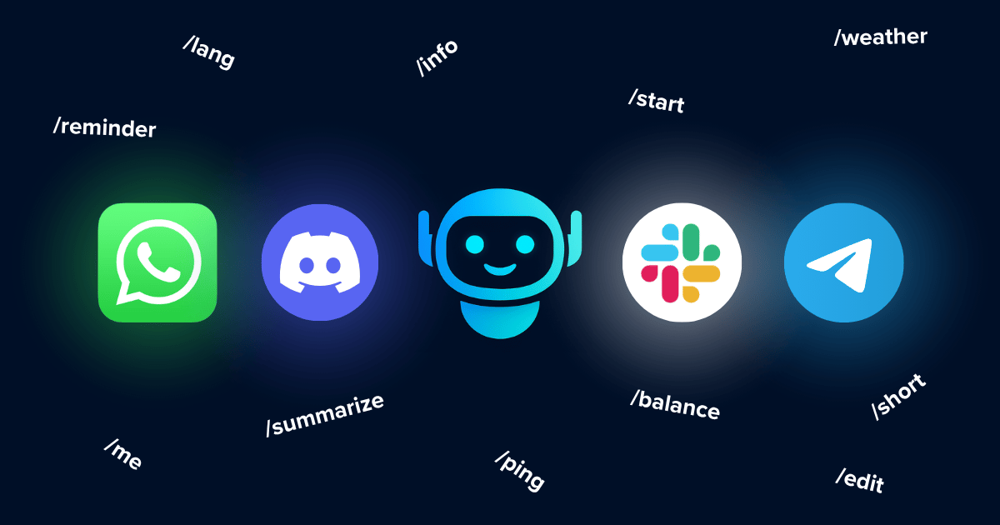
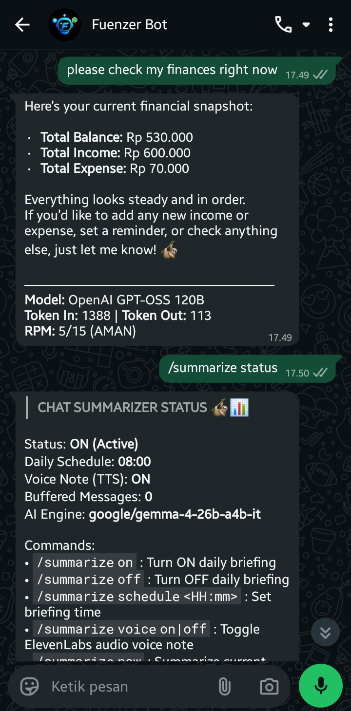
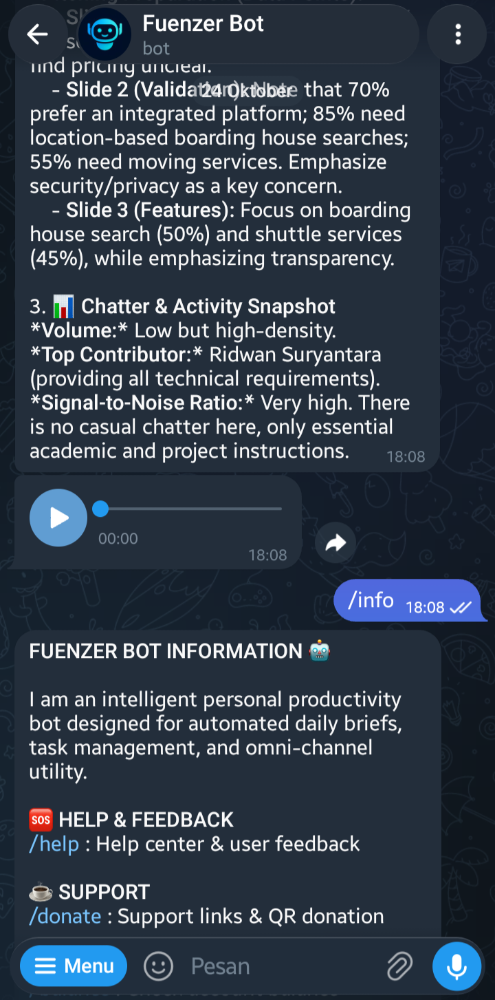

<p align="center">
  
</p>

<h1 align="center">Fuenzer Bot</h1>

<p align="center">
  <b>The Autonomous Omni-Channel Personal Productivity Assistant</b><br>
  Runs concurrently on WhatsApp & Telegram · Powered by Node.js, Supabase, and Serverless AI
</p>

<p align="center">
  <a href="https://github.com/Yogs4R/fuenzer-bot/releases"></a>
  <a href="https://github.com/Yogs4R/fuenzer-bot/actions/workflows/ci.yml"></a>
  
  
  
  
  
</p>

<p align="center">
  <a href="#what-is-fuenzer-bot">About</a> •
  <a href="#preview">Preview</a> •
  <a href="#features">Features</a> •
  <a href="#command-reference-table">Commands</a> •
  <a href="#installation">Installation</a> •
  <a href="docs/ARCHITECTURE.md">Architecture</a> •
  <a href="docs/CICD.md">CI/CD</a> •
  <a href="docs/PRD.md">PRD</a>
</p>

<h4 align="center">
  <a href="README.md">English</a> | <a href="README.id.md">Bahasa Indonesia</a>
</h4>

<p align="center">
  <a href="https://ko-fi.com/fuenzer" target="_blank" rel="noopener noreferrer">
    
  </a>
  &nbsp;&nbsp;
  <a href="https://saweria.co/fuenzer" target="_blank" rel="noopener noreferrer">
    
  </a>
</p>

---

## What is Fuenzer Bot?

**Fuenzer Bot** is a high-availability, standalone virtual assistant engineered to increase daily productivity by bringing financial management, multi-modal AI reasoning, document processing, and server monitoring directly into your everyday chat apps (WhatsApp & Telegram) with zero context switching.

* **🔄 Omni-Channel Architecture:** Operates simultaneously on WhatsApp (via Baileys) and Telegram (via Telegraf).
* **🌐 Bilingual & Internationalized:** Default English (`en`) for global evaluation with native Indonesian (`id`) support via `/lang [en|id]` and 1-to-1 bilingual command aliases.
* **🦥 Automated Morning Briefings:** Passively buffers group chat clutter and delivers scheduled executive summaries via Google Gemma and soothing ElevenLabs voice notes.
* **🔒 Privacy-First AES-256-GCM Encryption:** All buffered group messages and sender names are encrypted at rest with AES-256-GCM (`iv:authTag:ciphertext`) with an automated 24-hour retention purge.
* **💰 Frictionless Personal Finance:** Track income and expenses on-the-fly, inspect real-time balances, and render visual monthly charts.
* **🛠 Swiss Army Knife Utilities:** Generate/convert WebP stickers, remove image backgrounds, compress/merge PDFs, and monitor cloud VM server health.

---

## Preview

<p align="center">
  
  &nbsp;&nbsp;&nbsp;&nbsp;
  
</p>
<p align="center">
  <i>Seamless dual-platform interface: Native WhatsApp formatting (left) and Telegram rich HTML (right).</i>
</p>

---

## Index

- [What is Fuenzer Bot?](#what-is-fuenzer-bot)
- [Preview](#preview)
- [Features](#features)
- [Command Reference Table](#command-reference-table)
  - [Admin Commands Table](#admin-commands-table)
- [Installation](#installation)
- [Configuration](#configuration)
- [VM Deployment Tutorial (From Scratch to PM2 Start)](#vm-deployment-tutorial-from-scratch-to-pm2-start)
- [CI/CD and Auto Release](#cicd-and-auto-release)
  - [A. Setup Repository Secrets & Variables](#a-setup-repository-secrets--variables)
  - [B. Setup Firewall for Auto Broadcast Webhook](#b-setup-firewall-for-auto-broadcast-webhook)
  - [C. Workflow Overview & Triggering Releases](#c-workflow-overview--triggering-releases)
  - [D. Detailed CI/CD & Troubleshooting Guide](#d-detailed-cicd--troubleshooting-guide)
- [Supabase Database Schema](#supabase-database-schema)
- [Updating Local Code (Without Losing Changes)](#updating-local-code-without-losing-changes)
- [Google Sheets Integration Tutorial (Customer Service)](#google-sheets-integration-tutorial-customer-service)

## Features

### 🔄 Multi-Platform Integration
Runs simultaneously, independently but fully integrated:
- **WhatsApp Bot** (powered by Baileys)
- **Telegram Bot** (powered by Telegraf)

### 🌐 Bilingual Support & i18n
Seamless internationalization catering to both global and Indonesian users:
- **Default English (`en`)**: Ready for international evaluation and global communities.
- **Indonesian (`id`) Toggle**: Switch language preferences on-the-fly using `/lang en` or `/lang id` (or `/bahasa id`).
- **1-to-1 Bilingual Aliases**: Execute commands seamlessly in either English or Indonesian (e.g., `/balance` ↔ `/saldo`, `/record` ↔ `/catat`, `/weather` ↔ `/cuaca`, `/remind` ↔ `/ingatkan`).
- **Tolerant Caching & Fallbacks**: In-memory caching with Supabase persistence and graceful offline fallback.

### 🔒 Data Privacy & Field-Level Encryption (AES-256-GCM)
Strict zero-knowledge data privacy engineered for conversational security:
- **AES-256-GCM at Rest**: All sensitive persisted conversation bodies, sender names, and room names in `chat_buffer` are encrypted application-side using AES-256-GCM in format `iv:authTag:ciphertext`.
- **Authenticated Integrity Verification**: Every payload contains a 16-byte cryptographic auth tag (`AEAD`), rejecting corrupted or tampered records.
- **Fail-Closed Security**: Ingestion strictly requires `ENCRYPTION_KEY`; if the key is missing, buffering safely halts to prevent persisting unencrypted data.
- **Ephemeral 24-Hour Retention**: Group messages buffered for AI morning summaries are subject to an automated 24-hour grace period purge after processing, and inactive unsummarized messages expire after 7 days.

### 🦥 Automated Morning Briefing & Chat Summarizer (Google Gemma & ElevenLabs)
Designed for the DEV Challenge Week 3 ("Slow and Steady"):
- **Google Gemma 4 (`google/gemma-4-26b-a4b-it`)**: Reads through cluttered group conversations to eliminate the chore of manually catching up on hundreds of unread messages.
- **Three-Part Structured Sloth Briefing**:
  1. 🦥 **Sloth TL;DR**: 2–3 sentence executive summary of core discussions and group sentiment.
  2. 🎯 **Key Action Items & Mentions**: Concise bullet points of tasks, decisions, deadlines, and questions.
  3. 📊 **Chatter & Noise Statistics**: Volume assessment and signal-to-noise ratio.
- **🎙️ ElevenLabs Native Audio Briefing**: Automatically synthesizes the Sloth TL;DR executive summary into a calm, soothing voice note (default: Rachel `21m00Tcm4TlvDq8ikWAM`) and sends it directly as a native voice message (WhatsApp PTT waveform / Telegram Voice Note) alongside the text briefing.
- **Automated Morning Delivery**: Dispatches a private morning briefing at a scheduled time (default `08:00`) directly to your DM via WhatsApp or Telegram.
- **Full Bilingual Command Interface**:
  - `/summarize on` / `/ringkas on` : Activate automated morning briefing.
  - `/summarize off` / `/ringkas off` : Deactivate daily briefing.
  - `/summarize schedule <HH:mm>` / `/ringkas jadwal <HH:mm>` : Customize delivery time (e.g. `/summarize schedule 07:30`).
  - `/summarize voice [on|off]` / `/ringkas voice [on|off]` : Toggle ElevenLabs audio voice note attachments.
  - `/summarize now` / `/ringkas sekarang` : Instantly summarize the current buffer directly in the chat.
  - `/summarize status` / `/ringkas status` : Check active schedule, voice note status, buffer count, and AI model.

### 🤖 AI Assistant
Advanced smart assistant powered by large language models (LLM) via OpenRouter API integration. Ready to answer technical questions, discussions, and coding.
- **Multimodal** support (capable of reading Images, and extracting Text Documents).
- **AI Agent Harness (Natural Language Tool Calling)**: Beyond manual slash commands, users can chat casually in English or Indonesian to log expenses (*"Bro, log $15 for lunch and check weather in Tokyo"*), set reminders (*"Remind me in 30m to check the oven"*), query prayer times, or search books. The harness automatically maps conversational intents to domain tools with warm, friendly confirmations.
- **Fast Translator** command using `/translate`.
- Multi-model support with user-level model switching command.
- Built-in model usage metadata in replies (token usage and RPM label).
- Supports multilingual answers by following the user's input language.
- Full bilingual command aliases and localized response outputs across all modules.

### 📚 Research Tools
Research references powered by multiple public APIs (no API key required):
- Book discovery from Open Library, journal lookup from Crossref, and scientific article lookup from OpenAlex.
- Journal lookup can also be used to search article references by topic keywords.
- Returns title, authors, year, and source link (DOI/Open Access PDF when available).
- Better fallback messages for timeout/down/network errors per provider.

### ⬇️ Downloader Tools
Unified downloader commands for social media and music:
- Supports media downloads from Instagram, Twitter/X, YouTube, and TikTok.
- Supports audio downloads from YouTube and YouTube Music.
- Built-in URL shortener utility via is.gd.

### 💰 Finance Management
Interactive financial logging directly from chat:
- Check current balance
- Dynamic income and expense logging
- Visual reports in chart format
- Paginated transaction history with control buttons
- Ability to delete (with confirmation) and edit transactions

### 🗂️ Media and File Converter
Powerful file and media conversion services with batch support:
- Image conversion, compress, rotate, resize, remove background, to web screenshots.
- PDF document operations: Word/Docx to PDF, compress PDF, rotate, extract pages, to merge various PDF files into a single document.
- Sticker generator for WhatsApp and Telegram image input.

### 🖥️ System and Server Monitoring
Reliable backend infrastructure with monitoring support:
- Hardware metrics monitoring (CPU, RAM, and Uptime).
- Regular website uptime monitoring.
- Command Usage Tracker to report top-tier user statistics and most popular commands.
- Admin command center for monitor checks, usage tracker, and broadcast tools.
- Monitor cron job sends notification only when any monitored website is down.

### 🛠️ Daily Utilities
Useful companion services:
- Reminder & Cronjob (Daily/One-time reminder with loop options)
- Prayer times checker per city
- Real-time weather condition checker per city
- *About Me* creator portfolio module
- Donation module with Ko-fi and Saweria QR delivery in chat.

### 🆘 Customer Service & Feedback
Simple ticketing system to receive user questions and feedback:
- Forwards questions (`/ask`) and feedback (`/feedback`) directly to Google Sheets using Google Apps Script.
- Automated sentiment analysis directly inside the Spreadsheet (Positive, Negative, Neutral).
- Reply to user questions straight from the bot using the `/answer` command (Admin only).

---

## Command Reference Table

### 1. English Commands (`en` - Default)

| Command | Description | Library Used | Example Usage |
|---|---|---|---|
| `/start` | Start bot and show quick menu | Baileys, Telegraf | `/start` |
| `/info` | Show command categories and bot guide | Baileys, Telegraf | `/info` |
| `/lang`, `/language` | Check or switch bot interface language (`en` or `id`) | languageService, Supabase | `/lang en`, `/lang id` |
| `/ping` | Check bot online status and system resource stats | Node.js os module | `/ping` |
| `/balance` | Show latest wallet balance summary | financeService, Supabase | `/balance` |
| `/record`, `/expense` | Record expense transaction | financeService, Supabase | `/record 25000 lunch` |
| `/income` | Record income transaction | financeService, Supabase | `/income 150000 freelance` |
| `/chart` | Generate finance visual chart report | financeService, QuickChart | `/chart` |
| `/history` | Show paginated transaction history | financeService, Supabase | `/history 2` |
| `/edit` | Edit transaction by id and field | financeService, Supabase | `/edit 123e4567 30000 dinner` |
| `/delete` | Delete transaction with confirmation | financeService, Supabase | `/delete 123e4567` |
| `/weather` | Show weather forecast by city | weatherService, OpenWeather | `/weather bandung` |
| `/prayer` | Show daily prayer times by city | religionService, MyQuran API | `/prayer bandung` |
| `/remind` | Add reminder, recurrence option, target time | reminderService, node-cron, Supabase | `/remind add 15m Laundry` |
| `/about`, `/me` | Show creator profile and links | aboutService | `/about` |
| `/book` | Search book references | Open Library API, axios | `/book clean code` |
| `/journal` | Search journal and article references | Crossref API, axios | `/journal machine learning` |
| `/article` | Search scientific article references | OpenAlex API, axios | `/article deep learning` |
| `/translate` | Translate text or replied message to a target language | aiClient, OpenRouter | `/translate id Hello world` |
| `/model_info` | Show available AI models and aliases | OpenRouter, aiPreferenceService | `/model_info` |
| `/switch` | Switch active AI model per user | OpenRouter, aiPreferenceService | `/switch gemma4` |
| `/summarize` | AI group chat summarizer & morning briefing (`on`, `off`, `schedule <HH:mm>`, `voice on\|off`, `now`, `status`) | summarizeService, OpenRouter Gemma, ElevenLabs, node-cron | `/summarize on`, `/summarize voice on`, `/summarize now` |
| `/browse` | Cloud browser agent: navigate web, bypass bot protections, take screenshot, extract text | browserbaseService, Playwright Core, Browserbase CDP | `/browse github.com` |
| `/help` | Show help center and Customer Service menu | csService | `/help` |
| `/feedback` | Send feedback (saved to Google Sheets) | csService, GAS | `/feedback great bot` |
| `/ask` | Send question to admin via CS | csService, GAS | `/ask how to donate?` |
| `/download` | Download media from social platforms (IG, TikTok, X, YT) | downloaderService | `/download https://...` |
| `/audio` | Extract audio from YouTube | downloaderService | `/audio https://...` |
| `/img` | Image convert, resize, rotate, compress | converterService, Sharp | `/img to png` |
| `/removebg` | Remove image background | converterService, remove.bg API | `/removebg` |
| `/screenshot`, `/ss` | Capture website screenshot | converterService, html-to-image | `/ss https://example.com` |
| `/topdf` | Convert document/media to PDF | converterService, CloudConvert | `/topdf` |
| `/pdf` | Compress, convert, rotate, extract, merge PDF | converterService, CloudConvert, PDF tools | `/pdf compress` |
| `/sticker` | Convert image or short video to sticker | stickerService | `/sticker` (reply to photo) |
| `/short`, `/shortlink` | Shorten URL using is.gd | shortenerService, is.gd API | `/short https://github.com` |
| `/donate` | Show support links and donation QR | donateService | `/donate` |

### 2. Indonesian Command Aliases (`id` - Bahasa Indonesia)

| Command (ID) | English Equivalent | Deskripsi | Contoh Penggunaan |
|---|---|---|---|
| `/bahasa` | `/lang` | Cek atau ganti bahasa bot | `/bahasa id`, `/bahasa en` |
| `/saldo` | `/balance` | Tampilkan ringkasan saldo keuangan | `/saldo` |
| `/catat`, `/pengeluaran` | `/record`, `/expense` | Catat pengeluaran keuangan | `/catat 25000 makan siang` |
| `/pemasukan` | `/income` | Catat pemasukan keuangan | `/pemasukan 150000 freelance` |
| `/laporan_chart` | `/chart` | Tampilkan grafik keuangan | `/laporan_chart` |
| `/riwayat` | `/history` | Tampilkan riwayat transaksi | `/riwayat 2` |
| `/hapus` | `/delete` | Hapus transaksi | `/hapus 123e4567` |
| `/cuaca` | `/weather` | Cek cuaca kota | `/cuaca jakarta` |
| `/sholat`, `/jadwalsholat` | `/prayer` | Cek jadwal sholat kota | `/sholat jakarta` |
| `/ingatkan` | `/remind` | Buat jadwal pengingat | `/ingatkan add 10m jemuran` |
| `/buku` | `/book` | Cari referensi buku | `/buku clean code` |
| `/jurnal` | `/journal` | Cari jurnal ilmiah | `/jurnal machine learning` |
| `/artikel`, `/paper` | `/article`, `/paper` | Cari artikel ilmiah | `/artikel healthcare` |
| `/terjemah`, `/terjemahkan` | `/translate` | Terjemahkan teks | `/terjemah en Selamat pagi` |
| `/model`, `/models` | `/model_info` | Daftar model AI yang tersedia | `/model` |
| `/ringkas` | `/summarize` | Ringkas chat grup & briefing pagi otomatis | `/ringkas on`, `/ringkas sekarang`, `/ringkas jadwal 07:30`, `/ringkas voice on` |
| `/jelajah` | `/browse` | Buka web via browser cloud anti-bot, ambil screenshot, dan ekstrak teks | `/jelajah detik.com` |
| `/bantuan` | `/help` | Bantuan & CS | `/bantuan` |
| `/saran` | `/feedback` | Kirim feedback ke Google Sheets | `/saran bot mantap` |
| `/unduh` | `/download` | Unduh media sosial | `/unduh https://...` |
| `/suara` | `/audio` | Unduh audio YouTube | `/suara https://...` |
| `/shortlink`, `/pendekkan` | `/short` | Pendekkan link URL | `/shortlink https://...` |
| `/hapusbg` | `/removebg` | Hapus latar belakang gambar | `/hapusbg` |
| `/tosticker` | `/sticker` | Ubah media jadi stiker | `/tosticker` |

### Admin Commands Table

| Command | Description | Library Used | Example Usage |
|---|---|---|---|
| /admin | Open admin command center | auth util, admin command module | /admin |
| /monitor | Run website status check manually | monitorService | /monitor |
| /cmd_usage | Show top command usage stats | admin module, log service | /cmd_usage |
| /ai_usage | Show AI usage stats by model | admin module, log service | /ai_usage |
| /broadcast | Send admin broadcast to users | admin module, WhatsApp/Telegram clients | /broadcast maintenance tonight |
| /answer | Reply to user question (admin only) | csService, admin module | /answer 628123xxx admin message |

---

## Installation

1. Clone the repository
```bash
git clone https://github.com/Yogs4R/fuenzer-bot.git
cd yoga-bot
```

2. Install dependencies
```bash
npm install
```

3. Configure credentials
Copy the `.env.example` file to `.env` and adjust it with your API keys and tokens (Supabase, Telegram, OpenRouter, CloudConvert, RemoveBg).

4. Run the application
```bash
npm start
```

## Configuration

The `.env` file contains all essential configuration strings. Copy `.env.example` to `.env` and fill the variables completely (without any extra quotes).

**Key Configuration Explanations:**
- **WhatsApp**: `WA_SESSION_DIR` (Auth data folder), `WA_PHONE_NUMBER` (Bot's phone number), `BOT_WA_LID` (Specific bot WhatsApp LID if needed).
- **Telegram**: `TELEGRAM_BOT_TOKEN` and `TELEGRAM_BOT_USERNAME` (From BotFather), and `TELEGRAM_SESSION_DIR` (Session folder).
- **Database (Supabase)**: `SUPABASE_URL`, `SUPABASE_PUBLISHABLE_KEY` (Anon public key), `SUPABASE_SECRET_KEY` (Service role to bypass RLS for admin).
- **AI APIs**: `GEMINI_API_KEY` or `OPENROUTER_API_KEY` (with optional `GEMMA_MODEL` for default summarizer model, default: `google/gemma-4-26b-a4b-it`).
- **Internationalization (i18n)**: `DEFAULT_LANGUAGE` (Default bot locale, `en` for English or `id` for Indonesian).
- **Partner APIs (Speech & Audio - ElevenLabs)**: `ELEVENLABS_API_KEY` for text-to-speech voice note synthesis, with optional `ELEVENLABS_VOICE_ID` (default: Rachel `21m00Tcm4TlvDq8ikWAM`) and `ELEVENLABS_MODEL_ID` (default: `eleven_multilingual_v2`).
- **Partner APIs (Cloud Browser Automation - Browserbase)**: `BROWSERBASE_API_KEY` and `BROWSERBASE_PROJECT_ID` for managed cloud browser execution, anti-bot/CAPTCHA bypass, screenshot rendering, and live debug inspector links.
- **Other APIs**: `OPENWEATHER_API_KEY` for weather features, `REMOVEBG_API_KEY`, `CLOUDCONVERT_API_KEY`, *HCTI* (web screenshots), and `GAS_WEBAPP_URL` for Google Sheets feedback service.
- **Security & Data Privacy (AES-256-GCM)**: `ENCRYPTION_KEY` (32-byte secret key used to encrypt group chats at rest). Generate a secure 64-character hex key (32 bytes) by running:
  ```bash
  node -e "console.log(require('crypto').randomBytes(32).toString('hex'))"
  ```
- **Monitoring**: `MONITOR_URLS` (Websites monitored by the bot) and `MONITOR_INTERVAL` (Interval gap, e.g. 300000ms = 5 minutes).

*Note: The cron job for server health reports runs every morning (06:00, server time) and sends a message only when one or more monitored websites are down. If all websites are healthy, no alert message is sent.*

---

## VM Deployment Tutorial (From Scratch to PM2 Start)

This guide is tested on Ubuntu 22.04 / 24.04 LTS and Debian 12.

### Option 1: Automated 1-Line Setup (Recommended)
Run our automated provisioning script directly on your clean VM terminal to automatically install Node.js 20 LTS, `ffmpeg`, `build-essential`, `pm2`, and configure UFW firewall rules:

```bash
curl -fsSL https://raw.githubusercontent.com/Yogs4R/fuenzer-bot/main/scripts/setup-vm.sh | bash
```

Once the script completes, simply launch the bot:
```bash
# 1. Clone repository
git clone https://github.com/Yogs4R/fuenzer-bot.git ~/fuenzer-bot
cd ~/fuenzer-bot

# 2. Install dependencies & configure .env
npm install
cp .env.example .env
nano .env

# 3. Start & persist process with PM2
pm2 start src/index.js --name fuenzerbot
pm2 save
pm2 startup
```

<details>
<summary><b>Option 2: Manual Step-by-Step Installation</b></summary>

1. **SSH into your VM:**
   ```bash
   ssh username@vm-ip
   ```
2. **Install system dependencies & ffmpeg:**
   ```bash
   sudo apt update && sudo apt upgrade -y
   sudo apt install -y git curl build-essential ffmpeg ca-certificates
   ```
3. **Install Node.js 20 LTS & PM2:**
   ```bash
   curl -fsSL https://deb.nodesource.com/setup_20.x | sudo -E bash -
   sudo apt install -y nodejs
   sudo npm install -g pm2
   ```
4. **Configure UFW Firewall (SSH + Webhook 3000):**
   ```bash
   sudo ufw allow ssh
   sudo ufw allow 3000/tcp
   sudo ufw reload
   ```
5. **Clone, Configure & Start:**
   ```bash
   git clone https://github.com/Yogs4R/fuenzer-bot.git
   cd fuenzer-bot
   npm install
   cp .env.example .env
   nano .env
   pm2 start src/index.js --name fuenzerbot
   pm2 save
   pm2 startup
   ```
</details>

### Useful PM2 Commands:
```bash
pm2 status                  # Check bot status & memory usage
pm2 logs fuenzerbot --lines 100 # View live bot logs
pm2 restart fuenzerbot      # Restart bot process
pm2 stop fuenzerbot         # Stop bot
```

---

## CI/CD and Auto Release

This repository uses automated workflows for CI testing, remote VM deployment, automated GitHub releases, and real-time broadcast announcements to WhatsApp & Telegram.

### A. Setup Repository Secrets & Variables
To enable CI/CD auto-deployment and the auto broadcast release feature, configure Secrets in your GitHub Repository (`Settings > Secrets and variables > Actions > New repository secret`):
- `HOST`: Your VM IP address (used for SSH deploy, optional but recommended).
- `USERNAME`: Your VM SSH username (e.g., `my_vm`).
- `SSH_KEY`: Your private SSH key for accessing the VM automatically.
- `VM_IP`: Your VM IP (used as the webhook URL target).
- `AUTO_BROADCAST_RELEASE`: The secret password you set in the `.env` file of your VM for the webhook endpoint security.

### B. Setup Firewall for Auto Broadcast Webhook
The auto-broadcast webhook endpoint runs on port `3000` by default. You must open this port in your VM internal firewall securely so GitHub Actions can reach it. Make sure not to block your SSH access (`22`).

```bash
sudo ufw allow ssh
sudo ufw allow 3000/tcp
sudo ufw reload
sudo ufw status
```

### C. Workflow Overview & Triggering Releases
1. **Pull Requests & Commits (`ci.yml`):** Automatically scanned by Gitleaks for secrets, verified against forbidden credential files (`.env`, `auth/`, `credentials/`), and checked for JS syntax validity.
2. **Push to `main` (`deploy.yml`):** Automatically pulls the latest code to your VM via SSH and restarts PM2 (`fuenzerbot`).
3. **Triggering a Release (`auto-release.yml`):**
   Follow conventional commits (`feat:`, `fix:`, `refactor:`, `chore:`) and push a semver version tag:
   ```bash
   git tag v1.1.0
   git push origin v1.1.0
   ```
   This automatically generates formatted release notes, creates the GitHub Release, and POSTs a webhook to your bot to broadcast the *What's New* changelog directly to users.

### D. Detailed CI/CD & Troubleshooting Guide
For the complete technical breakdown—including `.github/changelog-config.json` rules, CI/CD smoke test commands, common errors (`Empty CHANGELOG`, `401 Unauthorized`), and tag rollback procedures—see the dedicated documentation:
👉 **[Detailed CI/CD & Release Documentation (`docs/CICD.md`)](./docs/CICD.md)**

---

## Supabase Database Schema

Please make sure to have RLS (Row Level Security) enabled when creating these tables under your Supabase project.

```sql
-- command_logs table:
-- Stores the command usage history by users for statistical purposes.
CREATE TABLE command_logs (
    id UUID DEFAULT uuid_generate_v4() PRIMARY KEY,
    user_id TEXT NOT NULL,
    platform TEXT NOT NULL,
    command TEXT NOT NULL,
    created_at TIMESTAMPTZ DEFAULT NOW()
);

-- user_preferences table:
-- Stores user preferences, such as their currently active AI model.
CREATE TABLE user_preferences (
    user_id TEXT PRIMARY KEY,
    platform TEXT,
    active_model TEXT DEFAULT 'openai/gpt-oss-120b',
    language VARCHAR(5) DEFAULT 'en',
    updated_at TIMESTAMPTZ DEFAULT NOW()
);

-- ai_logs table:
-- Stores AI interaction logs, including the used model and token consumption.
CREATE TABLE ai_logs (
    id UUID DEFAULT uuid_generate_v4() PRIMARY KEY,
    user_id TEXT NOT NULL,
    platform TEXT NOT NULL,
    model TEXT NOT NULL,
    prompt TEXT,
    input_tokens INT,
    output_tokens INT,
    created_at TIMESTAMPTZ DEFAULT NOW()
);

-- api_quotas table:
-- Manages limits and tracks the usage of third-party API quotas (removebg, cloudconvert, etc.).
CREATE TABLE public.api_quotas (
  service text not null,
  usage integer null default 0,
  updated_at timestamp with time zone null default now(),
  "limit" integer null default 50,
  constraint api_quotas_pkey primary key (service)
) TABLESPACE pg_default;

-- Note: CloudConvert has a different limit
UPDATE api_quotas SET "limit" = 10 WHERE service = 'cloudconvert';

-- finance table:
-- Stores users' financial records (income & expenses).
CREATE TABLE public.finance (
  id uuid not null default gen_random_uuid (),
  user_id text null,
  amount bigint null,
  type text null,
  description text null,
  created_at timestamp with time zone null default now(),
  platform text null,
  updated_at timestamp with time zone null,
  constraint finance_pkey primary key (id)
) TABLESPACE pg_default;

-- reminders table:
-- Stores reminders and loops for the reminder feature
CREATE TABLE reminders (
  id TEXT PRIMARY KEY,
  user_id TEXT NOT NULL,
  message TEXT NOT NULL,
  trigger_time BIGINT NOT NULL,
  is_loop BOOLEAN DEFAULT FALSE,
  loop_interval BIGINT
);

-- chat_buffer table:
-- Stores ephemeral, AES-256-GCM encrypted group messages for AI morning summarization.
CREATE TABLE chat_buffer (
    id UUID PRIMARY KEY DEFAULT gen_random_uuid(),
    platform VARCHAR(30) NOT NULL,            -- 'whatsapp', 'telegram', 'discord', 'slack'
    chat_id VARCHAR(100) NOT NULL,            -- Group / Room identifier
    chat_name TEXT,                           -- Encrypted group title (AES-256-GCM)
    sender_name TEXT,                         -- Encrypted sender display name (AES-256-GCM)
    message_text TEXT NOT NULL,               -- Encrypted message body (AES-256-GCM)
    is_summarized BOOLEAN DEFAULT FALSE,
    created_at TIMESTAMPTZ DEFAULT NOW()
);

CREATE INDEX idx_chat_buffer_unsummarized 
    ON chat_buffer(platform, chat_id, is_summarized, created_at);

CREATE INDEX idx_chat_buffer_cleanup 
    ON chat_buffer(is_summarized, created_at);

-- user_summarize_settings table:
-- Stores preferences for automated morning briefing delivery per user or group.
CREATE TABLE user_summarize_settings (
    user_id VARCHAR(100) PRIMARY KEY,
    platform VARCHAR(30) NOT NULL,
    is_active BOOLEAN DEFAULT TRUE,
    schedule_time VARCHAR(5) DEFAULT '08:00',  -- 24h format (HH:mm)
    voice_note_enabled BOOLEAN DEFAULT TRUE,
    language VARCHAR(5) DEFAULT 'en',          -- 'en' or 'id'
    last_run_at TIMESTAMPTZ
);
```

---

## Updating Local Code (Without Losing Changes)

If you have modified the code locally and want to pull the latest updates from the repository without losing your changes, you can use the following git commands:

```bash
# Option 1: Using Git Stash
# 1. Stash your local changes
git stash
# 2. Pull the latest updates from the repository
git pull origin main
# 3. Apply your stashed changes back
git stash pop

# Option 2: Using Auto-Stash on Rebase (One liner)
# Automatically stashes unsaved changes, rebases against the latest main, 
# and pops the changes back seamlessly.
git pull --rebase --autostash
```

---

## Google Sheets Integration Tutorial (Customer Service)

The `/ask` and `/feedback` features require a Web App URL from Google Apps Script (GAS) to save incoming queries straight into a spreadsheet.

1. Create a new blank spreadsheet in [Google Sheets](https://sheets.google.com).
2. Set up headers on the first row (A1 - F1):
   `Timestamp` | `Type` | `User_ID` | `Message` | `Status` | `Customer Sentiment`
3. Create a table and name it "User Questions" or with anything you like.
4. In cell **F2** (Customer Sentiment), insert the following automated sentiment formula and drag it down to the subsequent rows:
   ```excel
   =IF(ISBLANK(D2), "", IF(REGEXMATCH(LOWER(D2), "good|great|excellent|awesome|love|thanks|thank you|happy|bagus|keren|mantap|terima kasih|suka|puas"), "Positive", IF(REGEXMATCH(LOWER(D2), "bad|terrible|awful|hate|issue|problem|error|fail|angry|upset|worst|poor|jelek|buruk|masalah|rusak|gagal|kecewa"), "Negative", "Netral")))
   ```
5. Click **Extensions > Apps Script** from the top menu.
6. Clear any existing code and paste the following snippet:
   ```javascript
   function doPost(e) {
    try {
      const sheet = SpreadsheetApp.getActiveSpreadsheet().getSheetByName("User Questions");
      
      // If the sheet is not found, stop the process to prevent errors.
      if (!sheet) throw new Error("Tab 'User Questions' tidak ditemukan!");
      const data = JSON.parse(e.postData.contents);

      if (data.action === "UPDATE_STATUS") {
        const dataRange = sheet.getDataRange();
        const values = dataRange.getValues();
        
        // Search from the bottom so that the latest questions from that user are updated.
        for (let i = values.length - 1; i >= 1; i--) {
          // Column C (index 2) is User_ID, Column E (index 4) is Status
          if (values[i][2].toString() === data.userId.toString() && values[i][4] === "UNANSWERED") {
            sheet.getRange(i + 1, 5).setValue("ANSWERED"); // Change cells in Column E
          }
        }
        return ContentService.createTextOutput(JSON.stringify({"status": "success", "message": "Status Updated"}))
          .setMimeType(ContentService.MimeType.JSON);
      }
      
      // Prepare data to be entered into a new row
      const rowData = [
        new Date(), 
        data.type,       // 'FEEDBACK' or 'ASK'
        data.userId,     // User's WA/Tele number
        data.message,    // Message content
        'UNANSWERED'     // Status default
      ];
      
      sheet.appendRow(rowData);
      
      return ContentService.createTextOutput(JSON.stringify({"status": "success"}))
        .setMimeType(ContentService.MimeType.JSON);
    } catch (error) {
      return ContentService.createTextOutput(JSON.stringify({"status": "error", "message": error.toString()}))
        .setMimeType(ContentService.MimeType.JSON);
    }
   }
   ```
7. Click **Deploy > New deployment**.
8. Select **Web app** as the deployment type. Set "Who has access" to **Anyone**.
9. Once successfully deployed, copy the generated Web App URL (ends with `/exec`).
10. Open your server's `.env` file and append the following environment variable then restart the bot:
   ```env
   GAS_WEBAPP_URL="YOUR_WEBAPP_URL_HERE"
   ```

