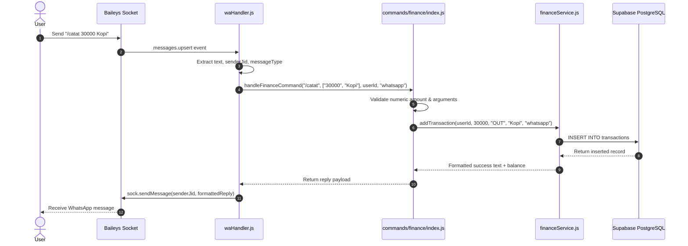
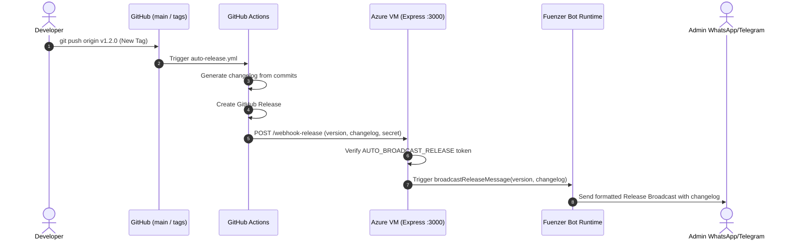
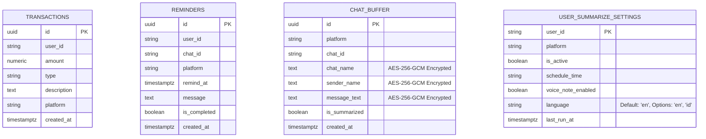

# System Architecture Document (ARCHITECTURE.md)
## Fuenzer Bot — Omni-Channel Personal Productivity Core

---

| **Document Metadata** | **Specification** |
| :--- | :--- |
| **Project** | Fuenzer Bot |
| **Author** | Yoga (@Yogs4R) |
| **Status** | **Approved / Active Architecture** |
| **Architecture Paradigm** | **Modular Hexagonal (Ports & Adapters)** |
| **Associated Documents** | [`AGENTS.md`](../AGENTS.md), [`docs/PRD.md`](./PRD.md), [`docs/PLANNING.md`](./PLANNING.md) |
| **Runtime Target** | Node.js v18+ LTS on Linux Cloud VM (PM2 Managed) |

---

## 1. Architectural Overview & System Paradigm

Fuenzer Bot is engineered following the **Ports & Adapters (Hexagonal) Architecture**. This ensures that the core domain logic (financial calculations, document conversion, AI prompt orchestration, and uptime monitoring) remains completely agnostic of the transport channel (WhatsApp, Telegram, Discord, or Slack).

```
                        ┌──────────────────────────────────────────┐
                        │              INBOUND PORTS               │
                        ├─────────────────┬────────────────────────┤
                        │ WhatsApp Socket │ Telegram Webhook/Poll  │
                        │ (Baileys)       │ (Telegraf)             │
                        └────────┬────────┴────────────┬───────────┘
                                 │                     │
                                 ▼                     ▼
                        ┌──────────────────────────────────────────┐
                        │      TRANSPORT ADAPTERS & DISPATCHER     │
                        │   (src/handlers/waHandler, teleHandler)  │
                        └──────────────────┬───────────────────────┘
                                           │
                                           ▼
┌──────────────────────────────────────────────────────────────────────────────────┐
│                             MODULAR COMMAND ROUTER                               │
│                         (src/commands/<category>/index.js)                       │
│    [admin] [ai] [converter] [devops] [finance] [google] [religion] [reminder]    │
└──────────────────────────────────────────┬───────────────────────────────────────┘
                                           │
                                           ▼
┌──────────────────────────────────────────────────────────────────────────────────┐
│                              DOMAIN SERVICES LAYER                               │
│                                 (src/services/)                                  │
│  financeService │ converterService │ aiPreferenceService │ monitorService │ ...  │
└───────────────────┬──────────────────────┬───────────────────────┬───────────────┘
                    │                      │                       │
                    ▼                      ▼                       ▼
┌─────────────────────────┐  ┌───────────────────────────┐  ┌─────────────────────┐
│  PERSISTENCE ADAPTER    │  │   SERVERLESS AI & MEDIA   │  │ THIRD-PARTY CLIENTS │
│  (Supabase PostgreSQL)  │  │   OpenRouter, Gemma API   │  │ Google Sheets API   │
│  - transactions         │  │   ElevenLabs Audio Engine │  │ BMKG/OpenWeather  │
│  - chat_buffer          │  │   Browserbase Cloud Agent │  │ CloudConvert/FFmpeg │
└─────────────────────────┘  └───────────────────────────┘  └─────────────────────┘
```

---

## 2. Invariant Architectural Decisions (ADs)

The following architectural decisions are binding across all modules and future pull requests:

* **`[AD-01] Transport Agnostic Services:`**
  * *Rule:* Files in `src/services/` must **never** reference `@whiskeysockets/baileys` socket instances or Telegraf context objects. Services must accept raw primitives/objects (`userId`, `amount`, `platform`, `buffer`) and return plain JavaScript data or formatted markdown strings.
  * *Prevents:* Tight coupling between business logic and messaging protocols.
* **`[AD-02] Modular Command Separation:`**
  * *Rule:* Command routing logic must live in `src/commands/<category>/index.js`. `waHandler.js` and `teleHandler.js` must act solely as thin dispatchers.
  * *Prevents:* Uncontrolled growth of monolithic handler files.
* **`[AD-03] Stateless Core with Ephemeral Memory Sessions:`**
  * *Rule:* Multi-step interactive workflows (such as `/pdf_merge`) maintain temporary state in-memory (`mergeSessions`), scoped by user JID with automatic TTL expiration. All durable facts (transactions, reminders, summarize preferences) are stored in Supabase PostgreSQL.
  * *Prevents:* Database write exhaustion for transient file-upload queues.
* **`[AD-04] Resilient WhatsApp Reconnect Loop:`**
  * *Rule:* Disconnection events emitted by Baileys (`connection.update` with `connection === 'close'`) must trigger a non-blocking exponential/randomized backoff reconnect (10–20 seconds) in `src/index.js`.
  * *Prevents:* Bot termination during WhatsApp server maintenance or IP address renewal.
* **`[AD-05] Ephemeral 24-Hour Retention for Summarized Chat Buffer:`**
  * *Rule:* Buffered group chats in Supabase (`chat_buffer`) must be marked `is_summarized = TRUE` upon delivery of the morning briefing. A daily automated cleanup task removes records where `is_summarized = TRUE AND created_at < NOW() - INTERVAL '24 hours'`. Unsummarized messages from inactive groups are purged after a 7-day fallback TTL.
  * *Prevents:* Database table bloating and privacy exposure while preserving a 24-hour grace period for auditing or re-summarization.
* **`[AD-06] Platform-Specific Markdown Formatting:`**
  * *Rule:* Outgoing text messages must be passed through `formatWhatsAppReply()` (asterisks `*bold*`, underscores `_italic_`) or formatted with HTML tags (`<b>`, `<i>`, `<code>`) for Telegram.
  * *Prevents:* Raw markdown syntax rendering awkwardly across disparate chat clients.
* **`[AD-07] Strict Read-Only Credentials Policy:`**
  * *Rule:* Folders `auth/`, `credentials/`, and `.env` are strictly protected. AI agents may inspect them for context, but must never edit or commit them. Configuration additions must update `.env.example`.
  * *Prevents:* Accidental leak or corruption of Baileys multi-device tokens or Google Service Account keys.
* **`[AD-08] Automated Remote Deployment on Main Push:`**
  * *Rule:* Any push to branch `main` triggers GitHub Actions (`.github/workflows/deploy.yml`), executing SSH commands to pull changes, run `npm install`, and restart the PM2 daemon (`pm2 restart fuenzerbot`).
  * *Prevents:* Manual SSH deployment overhead and service downtime.
* **`[AD-09] Field-Level Encryption at Rest (AES-256-GCM):`**
  * *Rule:* Sensitive user conversation data in Supabase (`chat_buffer.message_text`, `chat_buffer.chat_name`, `chat_buffer.sender_name`) and sensitive ledger notes must be encrypted prior to insertion via `src/utils/crypto.js` using AES-256-GCM (`iv:authTag:ciphertext`). Decryption occurs only at the application layer prior to AI summarization or user delivery.
  * *Prevents:* Plaintext exposure of user messages and privacy leaks inside cloud database tables.
* **`[AD-10] Bilingual Internationalization (i18n) & Command Aliasing:`**
  * *Rule:* The bot core defaults to English (`en`) for international hackathon evaluation, with Indonesian (`id`) toggleable per-user/group via `/lang [en|id]`. Command routers must register 1-to-1 bilingual aliases (e.g., `/balance` ↔ `/saldo`, `/record` ↔ `/catat`, `/weather` ↔ `/cuaca`) to preserve full backwards-compatibility.
  * *Prevents:* Breaking existing Indonesian user workflows while providing a native English experience for international judges.
* **`[AD-11] AI Agent Harness & Domain Service Tool-Calling:`**
  * *Rule:* The bot supports an AI Agent Harness (`src/services/aiHarnessService.js`) enabling users to execute actions via casual natural conversation. The AI harness translates conversational intents into standardized Tool/Function Calling schemas and dispatches execution solely to pure domain services (`src/services/*`), never directly touching transport sockets. Responses are returned in a friendly, conversational tone matching the configured language (`en` or `id`).
  * *Prevents:* Tight coupling between LLM tool-calling and chat client transports, ensuring bot features can be invoked either via classic slash commands or through conversational AI.

---

## 3. Component Details & Directory Mapping

```
fuenzer-bot/
├── src/
│   ├── index.js               # Application bootstrap, Express webhook server, reconnect loop
│   ├── config/
│   │   ├── constants.js       # Global constants, regex, error codes
│   │   └── settings.js        # Environment parser with fallback defaults
│   ├── handlers/
│   │   ├── waHandler.js       # WhatsApp Baileys message event listener & thin dispatcher
│   │   └── teleHandler.js     # Telegram Telegraf message listener & thin dispatcher
│   ├── commands/              # Modular Command Routing Layer
│   │   ├── admin/index.js     # /broadcast, /restart, /eval
│   │   ├── ai/index.js        # /ai, /ask, /model, /translate, /summarize
│   │   ├── converter/index.js # /img, /sticker, /toimg, /pdf_*
│   │   ├── devops/index.js    # /system, /ping, /checkweb
│   │   ├── finance/index.js   # /saldo, /catat, /pemasukan, /riwayat, /edit, /hapus
│   │   ├── google/index.js    # /sheet, /cs
│   │   ├── religion/index.js  # /jadwalsholat, /kiblat
│   │   ├── reminder/index.js  # /remind
│   │   └── weather/index.js   # /cuaca, /gempa
│   ├── services/              # Pure Domain Services (Business Logic)
│   │   ├── financeService.js  # Supabase ledger CRUD & chart generation
│   │   ├── converterService.js# Sharp, pdf-lib, fluent-ffmpeg, CloudConvert
│   │   ├── aiPreferenceService.js # Model switching & token statistics
│   │   ├── csService.js       # Google Sheets customer service sync
│   │   ├── monitorService.js  # OS metrics & HTTP website health ping
│   │   ├── downloaderService.js # Social media video/audio extractors
│   │   ├── aiHarnessService.js# (Upcoming) Natural language tool-calling & butler harness
│   │   └── summarizeService.js# (Upcoming) Gemma prompt builder & ElevenLabs voice synth
│   ├── jobs/                  # Background Cron Daemons
│   │   ├── serverMonitor.js   # Periodic website uptime polling
│   │   ├── reminderCron.js    # Supabase reminder trigger polling
│   │   └── summarizeCron.js   # (Upcoming) Daily 08:00 AM Sloth Briefing & Buffer Purge
│   ├── lib/                   # Outbound API Client Wrappers
│   │   ├── waClient.js        # Baileys socket factory
│   │   ├── telegramClient.js  # Telegraf instance
│   │   ├── supabaseClient.js  # Supabase client singleton
│   │   ├── openrouterClient.js# OpenRouter / Gemma client
│   │   └── googleClient.js    # Google API auth & Sheets client
│   ├── locales/               # Localization strings (i18n)
│   │   ├── en.json            # English translations (default)
│   │   └── id.json            # Indonesian translations
│   └── utils/
│       ├── auth.js            # Admin privilege validator (`isAdmin`)
│       ├── crypto.js          # Field-level AES-256-GCM encryption/decryption
│       ├── i18n.js            # Language switcher & translator helper
│       ├── formatter.js       # Currency, bullet lists, markdown adapters
│       ├── fileManager.js     # Temp file allocation & cleanup
│       └── logger.js          # Pino structured logger
```

---

## 4. Sequence & Data Flow Diagrams

### 4.1 Standard Command Ingestion Flow


---

### 4.2 Morning Sloth Briefing Flow (`docs/PLANNING.md`)
```mermaid
sequenceDiagram
    autonumber
    participant Cron as node-cron (08:00 AM)
    participant Buffer as Supabase chat_buffer
    participant Gemma as Google Gemma API
    participant Eleven as ElevenLabs Voice API
    participant Bot as Fuenzer Bot Dispatcher
    actor User as User Private DM

    Cron->>Buffer: Query unsummarized messages (is_summarized = false)
    Buffer-->>Cron: Return encrypted messages (iv:authTag:ciphertext)
    Cron->>Cron: Decrypt messages using AES-256-GCM
    Cron->>Gemma: POST /chat/completions (Strict Sloth Prompt in user's language)
    Gemma-->>Cron: 1. Sloth TL;DR (3 lines)<br/>2. Action Items<br/>3. Noise Ratio
    Cron->>Eleven: POST /v1/text-to-speech (Calm persona)
    Eleven-->>Cron: Audio binary buffer (audio/ogg)
    Cron->>Bot: Dispatch briefing text & voice note
    Bot->>User: Send text summary & native voice note to DM
    Cron->>Buffer: UPDATE chat_buffer SET is_summarized = true
    Cron->>Buffer: DELETE FROM chat_buffer WHERE is_summarized = true AND created_at < NOW() - 24 hours
```

---

### 4.3 Automated CI/CD & Auto-Release Webhook Flow


---

## 5. Storage & Database Architecture (Supabase)

### 5.1 Entity-Relationship (ER) Overview


### 5.2 Database Maintenance Policies
1. **Indexes:**
   - `idx_transactions_user_created`: `CREATE INDEX ON transactions (user_id, created_at DESC);`
   - `idx_chat_buffer_unsummarized`: `CREATE INDEX ON chat_buffer (is_summarized, created_at) WHERE is_summarized = FALSE;`
2. **Ephemeral Retention & Purge Policies:**
   - Supported via Node.js cron or PostgreSQL scheduled query:
   ```sql
   -- Purge summarized records after 24-hour grace period
   DELETE FROM chat_buffer 
   WHERE is_summarized = TRUE 
     AND created_at < NOW() - INTERVAL '24 hours';

   -- Purge stale unsummarized records from inactive groups after 7 days
   DELETE FROM chat_buffer 
   WHERE is_summarized = FALSE 
     AND created_at < NOW() - INTERVAL '7 days';
   ```

---

## 6. Fault Tolerance, Resilience & Edge Cases

| Failure Scenario | Impact | System Mitigation |
| :--- | :--- | :--- |
| **WhatsApp Socket Disconnect** | Baileys connection drops (`401`, `515`, stream reset) | `startWhatsAppBot()` catches close event and triggers randomized backoff retry (10–20s) without killing PM2 process. |
| **Supabase Outage / Offline** | Finance & reminder operations fail | Wrap all DB queries in `try/catch`. If Supabase is unreachable, return graceful error notice to chat; non-DB commands (converter, AI, system ping) continue operating. |
| **OpenRouter / AI Rate Limit (429)** | User prompt fails | Intercept 429 response, inspect `aiPreferenceService` to notify user or automatically fallback to secondary free model. |
| **Oversized Media File** | Potential memory leak / OOM during PDF conversion | `converterService.js` enforces strict input limit: `MAX_PDF_INPUT_SIZE = 10MB` and cleans up `/temp` files in `finally` blocks. |
| **Invalid Release Webhook Call** | Unauthorized external request | Request must match `process.env.AUTO_BROADCAST_RELEASE`. Returns `401 Unauthorized` immediately if secret is invalid. |

---

## 7. Deployment & Infrastructure Architecture

```
                    ┌───────────────────────────────────────────┐
                    │          DEVELOPER WORKSTATION            │
                    │   git commit -m "feat: ..." & git push    │
                    └─────────────────────┬─────────────────────┘
                                          │
                                          ▼
                    ┌───────────────────────────────────────────┐
                    │             GITHUB REPOSITORY             │
                    │      Triggers Workflows (.github/)        │
                    └──────────────┬─────────────────────┬──────┘
                                   │                     │
                     Push to main  │                     │ Tag v*
                                   ▼                     ▼
                    ┌──────────────────────┐  ┌─────────────────────────┐
                    │  deploy.yml (SSH)    │  │   auto-release.yml      │
                    │  Connects to Azure   │  │   POST /webhook-release │
                    └──────────────┬───────┘  └──────────┬──────────────┘
                                   │                     │
                                   ▼                     ▼
┌───────────────────────────────────────────────────────────────────────────────┐
│                          AZURE LINUX VM (Ubuntu LTS)                          │
│                                                                               │
│  ┌─────────────────────────────────────────────────────────────────────────┐  │
│  │                              PM2 RUNTIME                                │  │
│  │                                                                         │  │
│  │   [Process: fuenzerbot]                                                 │  │
│  │   ├── Express Server (:3000) ──────► /webhook-release                   │  │
│  │   ├── Baileys Client          ──────► WhatsApp Web Socket (Multi-Device)│  │
│  │   ├── Telegraf Polling        ──────► Telegram Bot API                  │  │
│  │   └── node-cron Schedulers    ──────► Health Monitor & 08:00 AM Sloth   │  │
│  │                                                                         │  │
│  └─────────────────────────────────────────────────────────────────────────┘  │
│                                                                               │
└───────────────────────────────────────────────────────────────────────────────┘
```

---
