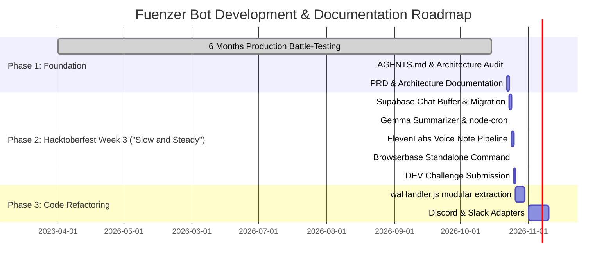

# Product Requirements Document (PRD)
## Fuenzer Bot — Omni-Channel Personal Productivity & Automation Bot

---

| **Document Metadata** | **Details** |
| :--- | :--- |
| **Product Name** | Fuenzer Bot (Personal Core) |
| **Author** | Yoga (@Yogs4R) |
| **Status** | **Final Draft (Review Ready)** |
| **Version** | `1.1.0-draft` |
| **Last Updated** | 2026-10-22 |
| **Target Milestone** | Hacktoberfest 2026 Challenge Week 3 ("Slow and Steady") & Production Hardening |
| **Associated Planning** | [`docs/PLANNING.md`](./PLANNING.md) |

---

## 1. Executive Summary & Vision

### 1.1 Overview
**Fuenzer Bot** is a high-availability, omni-channel personal productivity assistant designed to run concurrently on **WhatsApp** (via Baileys) and **Telegram** (via Telegraf), with architectural readiness for **Discord** and **Slack**. Developed and battle-tested over 6+ months in active production on a lightweight cloud VM (managed via PM2), Fuenzer Bot combines personal financial tracking, multi-modal AI reasoning, media file manipulation (PDF, images, stickers), host server monitoring, and third-party integrations (Google Sheets, BMKG, scientific journals).

### 1.2 The Problem
1. **Context Fragmentation:** Personal productivity tools are siloed across disconnected apps (finance tracker in one app, server alerts in email/SSH, file converters on sketchy web tools).
2. **Information Overload ("The Sloth Problem"):** Opening messaging platforms reveals hundreds of unread messages across noisy group chats, creating anxiety, wasted time, and missed commitments.
3. **Execution Friction:** Performing quick utilities (converting a PDF, checking host CPU/RAM, logging a freelance expense) requires switching windows or launching heavy desktop software.

### 1.3 The Solution & Value Proposition
Fuenzer Bot brings these utilities directly into the user's primary communication channels with zero context switching. For routine group clutter, the bot acts as an **autonomous butler** that passively buffers traffic and synthesizes a **concise Morning Sloth Briefing (Text + ElevenLabs Voice Note)**, eliminating the dreaded chore of manual chat scrolling.

---

## 2. Target Personas & Core User Journeys

### 2.1 Personas
* **Persona A: "The Solo Developer / Power User" (Primary)**
  * *Needs:* Rapid expense logging, instant server uptime checks, automated deployment changelogs broadcast to chat, and on-the-fly document conversions without opening browser tools.
* **Persona B: "The Overwhelmed Group Member" (Sloth Persona)**
  * *Needs:* Waking up to a clear 30-second audio voice summary and bulleted action items instead of sifting through 400+ unread group messages.
* **Persona C: "The Customer Service Manager"**
  * *Needs:* Automated synchronization of incoming inquiries from chat into Google Sheets for operational tracking.

### 2.2 Core User Journeys

#### Journey 1: Quick Daily Expense Logging
> **Actor:** User on WhatsApp/Telegram
> 1. User sends `/catat 35000 Nasi Padang` after lunch.
> 2. Bot validates parameters, cleans amount format, stores record to Supabase, and updates balance.
> 3. Bot replies with confirmation, updated balance, and category tag within 1 second.
> 4. At month-end, user sends `/laporan_chart` to receive a rendered visual financial graph.

#### Journey 2: Morning Sloth Briefing (Upcoming - `docs/PLANNING.md`)
> **Actor:** Sleeping User & Fuenzer Bot Scheduled Daemon
> 1. Throughout the day/night, the bot passively ingests unread group chats into Supabase `chat_buffer`.
> 2. At 08:00 AM, `node-cron` triggers `summarizeService`.
> 3. Google Gemma analyzes buffered text, extracting a 2–3 line summary, actionable mentions, and noise ratio.
> 4. ElevenLabs Voice API synthesizes the summary into a calming 30-second audio note.
> 5. Bot sends both text briefing and audio note to the user's private DM, then marks buffered messages as processed.

---

## 3. Functional Requirements (FR)

### 3.1 Module 1: Omni-Channel Transport & Dispatcher (`FR-COMM`)
* **FR-COMM-01:** **WhatsApp Connectivity.** Bot must maintain a persistent WebSocket session via Baileys Web client, with automated exponential backoff reconnect logic (10–20s) upon connection drop.
* **FR-COMM-02:** **Telegram Connectivity.** Bot must run concurrently via Telegraf polling, parsing commands and formatting outputs with Telegram-compliant HTML tags.
* **FR-COMM-03:** **Role-Based Authorization.** Administrative commands must strictly verify user identity against `ADMIN_NUMBERS` / `ADMIN_TELEGRAM_IDS` via `isAdmin()`.
* **FR-COMM-04:** **Automated CI/CD Webhook.** Express HTTP server must expose `POST /webhook-release` secured with `AUTO_BROADCAST_RELEASE` secret token to automatically broadcast GitHub release changelogs to configured admin channels.
* **FR-COMM-05 [ASSUMPTION]:** **Discord & Slack Ingestion.** Bot must provide adapter stubs to listen to target Discord server channels (`discord.js`) and Slack channels (`@slack/bolt`) for group message buffering.

### 3.2 Module 2: Personal Financial Management (`FR-FIN`)
* **FR-FIN-01:** **Balance Retrieval.** `/saldo` must query Supabase to calculate total income minus total expenses per user ID.
* **FR-FIN-02:** **Transaction Ingestion.** `/catat <amount> <desc>` (Expense) and `/pemasukan <amount> <desc>` (Income) must parse numeric values, strip formatting artifacts, and persist records with platform source metadata.
* **FR-FIN-03:** **Transaction History.** `/riwayat [limit]` must render paginated transaction lists (default: 5 items per page) with unique IDs.
* **FR-FIN-04:** **Transaction Modification.** `/edit <id> <amount> <desc>` and `/hapus <id>` must permit modification or deletion of specific user transactions.
* **FR-FIN-05:** **Visual Chart Generation.** `/laporan_chart` must aggregate recent transactions into a generated visual chart image sent directly to chat.

### 3.3 Module 3: Multi-Model AI Copilot (`FR-AI`)
* **FR-AI-01:** **Conversational Queries.** `/ai <prompt>` and `/ask <prompt>` must forward prompts to configured AI endpoints (OpenRouter/Groq).
* **FR-AI-02:** **Model Switching & Preferences.** `/model [name]` must allow runtime switching between supported models (e.g., DeepSeek, Gemma, Claude, GPT) and persist user preference.
* **FR-AI-03:** **Usage Footers.** All AI responses must automatically append system and token metadata (Model name, Token In/Out, and RPM status).
* **FR-AI-04:** **Language Translation.** `/translate <target_lang> <text>` (or via quote reply) must translate text using AI prompt pipelines.
* **FR-AI-05:** **Quota Management.** `/quota` must verify remaining API quotas and prompt limits to avoid hitting billing thresholds.

### 3.4 Module 4: "Slow and Steady" Sloth Summarizer (`FR-SLOTH`) *(Roadmap from PLANNING.md)*
* **FR-SLOTH-01:** **Passive Chat Buffer.** Bot must intercept incoming group messages across monitored channels and persist them to Supabase table `chat_buffer` (`platform`, `chat_id`, `chat_name`, `sender_name`, `message_text`).
* **FR-SLOTH-02:** **Buffer Toggle & Configuration.** Bot must support user commands:
  * `/summarize on` / `/summarize off`: Enable/disable group buffering.
  * `/summarize schedule <HH:mm>`: Set scheduled briefing delivery time (default: `08:00`).
  * `/summarize now`: Trigger immediate manual summarization.
  * `/summarize status`: Display active schedule, monitored groups, and buffered message count.
* **FR-SLOTH-03:** **Gemma Summarizer Engine.** Summarization engine must query Google Gemma (`google/gemma-2-9b-it` or `gemma-4-26b`) with strict prompt constraints:
  * Executive TL;DR (2–3 sentences).
  * Direct action items and actionable commitments with `@mention`.
  * Banter vs noise ratio statistic.
* **FR-SLOTH-04:** **ElevenLabs Voice Note Synthesis.** Executive summary text must be converted to high-quality audio via ElevenLabs TTS API using a calm persona voice and dispatched as a native voice message (`audio/ogg` or `audio/mp3`).
* **FR-SLOTH-05:** **7-Day Rolling Retention & Auto-Purge.** Once summarized, records are updated to `is_summarized = TRUE` and retained for 7 days (enabling re-audits or manual lookbacks). A daily automated cron task executes `DELETE FROM chat_buffer WHERE is_summarized = TRUE AND created_at < NOW() - INTERVAL '7 days'` to prevent database bloat.

### 3.5 Module 5: Media & Document Processing (`FR-MEDIA`)
* **FR-MEDIA-01:** **Sticker Creation & Inversion.** `/sticker` (`/s`) must convert static or animated media to WhatsApp WebP format with custom pack metadata. `/toimg` must convert WebP stickers back to standard JPEG/PNG images.
* **FR-MEDIA-02:** **Background Removal.** `/removebg` (`/nobg`) must strip image backgrounds using image processing APIs.
* **FR-MEDIA-03:** **HTML to Image.** `/htmltoimg <code>` must render raw HTML into rendered screenshot images.
* **FR-MEDIA-04:** **PDF Operations.**
  * `/pdf_rotate`: Rotates PDF pages clockwise/counter-clockwise.
  * `/pdf_extract`: Extracts specified page ranges into a new document.
  * `/pdf_compress`: Reduces document file size.
  * `/pdf_toimg` & `/img_topdf`: Bidirectional conversion between images and PDF.
* **FR-MEDIA-05:** **Interactive PDF Merge.** Bot must support interactive stateful merging via in-memory sessions (`mergeSessions`), allowing users to enqueue multiple PDFs and finalize merge via `/pdf_merge_done`.

### 3.6 Module 6: Server & Infrastructure Monitoring (`FR-MON`)
* **FR-MON-01:** **Host Diagnostics.** `/system` and `/ping` must output real-time CPU utilization percentage, RAM consumption (`used/total GB`), uptime duration, and OS details.
* **FR-MON-02:** **Website Health Monitoring.** Background scheduler (`jobs/serverMonitor.js`) must poll registered HTTP endpoints at periodic intervals and immediately broadcast alert notifications to admin DM if an endpoint goes down.

### 3.7 Module 7: Cloud Browser & Autonomous Agents (`FR-EXT`)
* **FR-EXT-01:** **Media Downloader.** Download media content from TikTok, Instagram, YouTube, and Twitter via `downloaderService` (`btch-downloader`).
* **FR-EXT-02:** **Customer Service Sheet Sync.** Incoming inquiries matching customer service criteria must sync to designated Google Sheets via `csService.js` and notify operators.
* **FR-EXT-03:** **Scientific & Book Research.** `/buku` and `/jurnal` must query Google Books and semantic scholar search endpoints.
* **FR-EXT-04:** **Religious & Civic Utilities.** `/jadwalsholat` and `/cuaca` / `/gempa` must deliver prayer time schedules and official BMKG geological alert cards.
* **FR-EXT-05 [ASSUMPTION]:** **Browserbase Cloud Runner.** Independent `/browse` command must spin up headless cloud sessions on Browserbase for anti-bot data extraction and visual verification without consuming local host resources.

---

## 4. Non-Functional Requirements (NFR)

* **NFR-PERF (Performance):**
  * Local command acknowledgment and response within **< 1.5 seconds**.
  * Large media conversion (PDF merge, video transcoder) processing within **< 15 seconds** (or stream immediate processing placeholder).
* **NFR-REL (Reliability & Fault Tolerance):**
  * Auto-reconnection loop on Baileys socket closure must run indefatigably with random/exponential backoff (10–20s) without killing the Node.js process.
  * Missing third-party API keys (e.g. Supabase, ElevenLabs) must disable respective commands gracefully with user-friendly notices rather than crashing the runtime.
* **NFR-SEC (Security & Data Governance):**
  * Zero exposure of sensitive secrets: `auth/`, `credentials/`, and `.env` strictly quarantined.
  * Administrative commands protected by hard checks against verified admin IDs.
* **NFR-PRIV (Privacy):**
  * Messages in `chat_buffer` are stored ephemerally solely for summarization and purged post-briefing.
* **NFR-MAINT (Code Maintainability):**
  * Command dispatchers must be strictly partitioned into `src/commands/<category>/index.js`, keeping `waHandler.js` and `teleHandler.js` as thin message transport adapters.

---

## 5. Data Architecture & Database Schemas (Supabase PostgreSQL)

```sql
-- 1. Financial Transactions
CREATE TABLE IF NOT EXISTS transactions (
    id UUID PRIMARY KEY DEFAULT gen_random_uuid(),
    user_id VARCHAR(100) NOT NULL,
    amount NUMERIC(15, 2) NOT NULL,
    type VARCHAR(10) NOT NULL CHECK (type IN ('IN', 'OUT')),
    description TEXT NOT NULL,
    platform VARCHAR(30) NOT NULL, -- 'whatsapp', 'telegram'
    created_at TIMESTAMPTZ DEFAULT NOW()
);

-- 2. Scheduled Reminders
CREATE TABLE IF NOT EXISTS reminders (
    id UUID PRIMARY KEY DEFAULT gen_random_uuid(),
    user_id VARCHAR(100) NOT NULL,
    chat_id VARCHAR(100) NOT NULL,
    platform VARCHAR(30) NOT NULL,
    remind_at TIMESTAMPTZ NOT NULL,
    message TEXT NOT NULL,
    is_completed BOOLEAN DEFAULT FALSE,
    created_at TIMESTAMPTZ DEFAULT NOW()
);

-- 3. Ephemeral Group Chat Buffer (Sloth Feature)
CREATE TABLE IF NOT EXISTS chat_buffer (
    id UUID PRIMARY KEY DEFAULT gen_random_uuid(),
    platform VARCHAR(30) NOT NULL,       -- 'whatsapp', 'telegram', 'discord', 'slack'
    chat_id VARCHAR(100) NOT NULL,       -- Group/Room JID
    chat_name VARCHAR(150),
    sender_name VARCHAR(100),
    message_text TEXT NOT NULL,
    is_summarized BOOLEAN DEFAULT FALSE,
    created_at TIMESTAMPTZ DEFAULT NOW()
);

-- 4. User Summarize & Briefing Preferences
CREATE TABLE IF NOT EXISTS user_summarize_settings (
    user_id VARCHAR(100) PRIMARY KEY,
    platform VARCHAR(30) NOT NULL,
    is_active BOOLEAN DEFAULT TRUE,
    schedule_time VARCHAR(5) DEFAULT '08:00',
    voice_note_enabled BOOLEAN DEFAULT TRUE,
    last_run_at TIMESTAMPTZ
);
```

---

## 6. Execution Roadmap & Release Milestones



---

## 7. Open Questions & Assumptions

* `[ASSUMPTION-01]` **Browserbase Usage Scope:** Assumed to be implemented as a dedicated `/browse <url/query>` utility command rather than directly embedded into the chat summarizer, keeping the summarizer flow lightweight.
* `[ASSUMPTION-02]` **Group Privacy Compliance:** WhatsApp Baileys inherently intercepts all incoming messages in groups where the user account is present; for Telegram, users must disable Privacy Mode in BotFather (`/setprivacy -> Disable`) or add the bot as admin for group buffering to work.
* `[RESOLVED-01]` **Data Retention for `chat_buffer`:** Settled on a **7-Day Rolling Retention**. Messages are flagged with `is_summarized = TRUE` immediately after processing, and purged automatically after 7 days via a scheduled cleanup routine (`DELETE FROM chat_buffer WHERE is_summarized = TRUE AND created_at < NOW() - INTERVAL '7 days'`).

---
